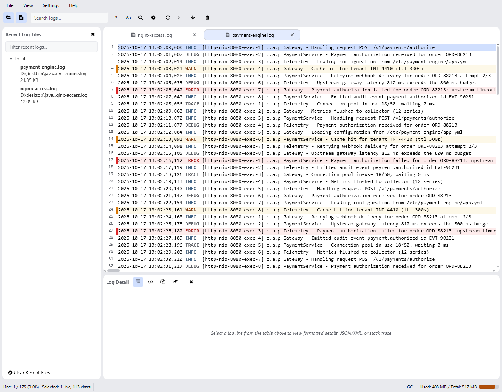

SeeLoggyPlus is a fast, lightweight log viewer for developers and operations teams.
It reads local log files and remote logs over SSH, filters and searches them, tails them
in real time, and formats embedded JSON or XML payloads.

## What you need

| Setup | Requirement |
| --- | --- |
| Portable package with JRE | Runs as-is on Windows and Linux; no Java installation required. |
| Portable package without JRE | Needs Java 21 or newer on the machine. |
| Remote logs | An SSH account on the server. Password and private-key authentication are supported. |

## Quick start

1. Open a file with **File → Open...** (<kbd>Ctrl+O</kbd>), or pick one from the **Recent Log Files** panel.
2. Type a keyword into the search field to highlight and filter matching lines.
3. Click a line to read its full content in the **Detail** panel; drag to select part of a line and press <kbd>Ctrl+C</kbd> to copy it.
4. Press the **Tail** button to follow a log in real time.
5. Add an SSH server in **Settings → Server Management...** (<kbd>Ctrl+M</kbd>) to browse and tail remote logs.

The main window after opening two local log files.

## Next steps

- [Installation](/installation/) — packages, launchers and Java requirements
- [Main Interface](/interface/) — the layout, tabs and status bar
- [Unified File Manager](/guides/file-manager/) — one browser for local and remote files
