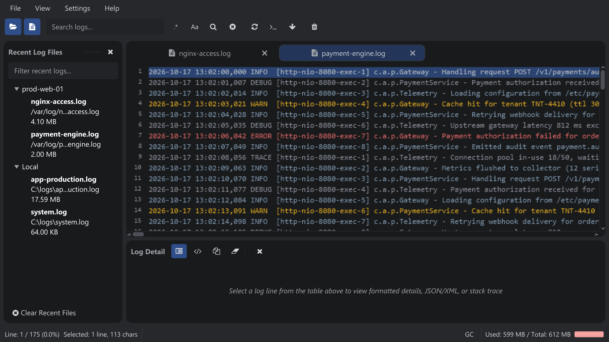

import { Steps } from '@astrojs/starlight/components';

SeeLoggyPlus is a fast, lightweight log viewer for developers and operations teams.
It reads local log files and remote logs over SSH, filters and searches them, tails them
in real time, and formats embedded JSON or XML payloads.

## What you need

| Setup | Requirement |
| --- | --- |
| Portable package with JRE | Runs as-is on Windows and Linux; no Java installation required. |
| Portable package without JRE | Needs Java 21 or newer on the machine. |
| Remote logs | An SSH account on the server. Password and private-key authentication are supported. |

## Quick start

<Steps>

1. **Download a package.** Open [GitHub Releases](https://github.com/ariefmahendra/seeloggyplus/releases/latest) and choose the Windows or Linux package **with JRE** so you do not need to install Java.
2. **Extract and launch.** Extract the entire ZIP. On Windows, run `launcher.bat`; on Linux, run `./launcher.sh`. See [Installation](/installation/) for launcher details and Java requirements.
3. **Open a local log.** Choose **File → Open...** (<kbd>Ctrl+O</kbd>), then select a log file in the Unified File Manager.
4. **Search for text.** Type `ERROR` into the search field to highlight and filter matching lines.
5. **Read the details.** Click a line to read it in full in the **Detail** panel. Drag to select text, then press <kbd>Ctrl+C</kbd> to copy it.
6. **Follow new lines.** Press the **Tail** button in the toolbar to follow the log in real time.

</Steps>

The main window after opening two local log files. Select the image to enlarge it.

## Next steps

- [Installation](/installation/) — packages, launchers and Java requirements
- [Main Interface](/interface/) — the layout, tabs and status bar
- [Unified File Manager](/guides/file-manager/) — one browser for local and remote files
- [Server Management](/reference/server-management/) — add an SSH connection to browse and tail remote logs
