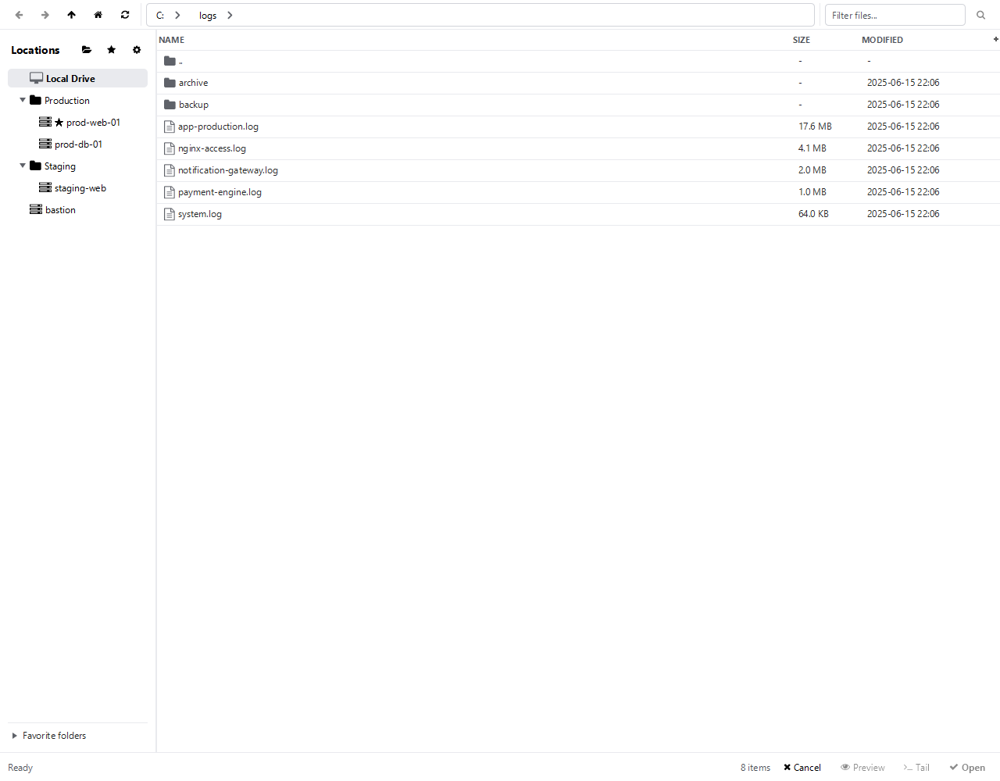
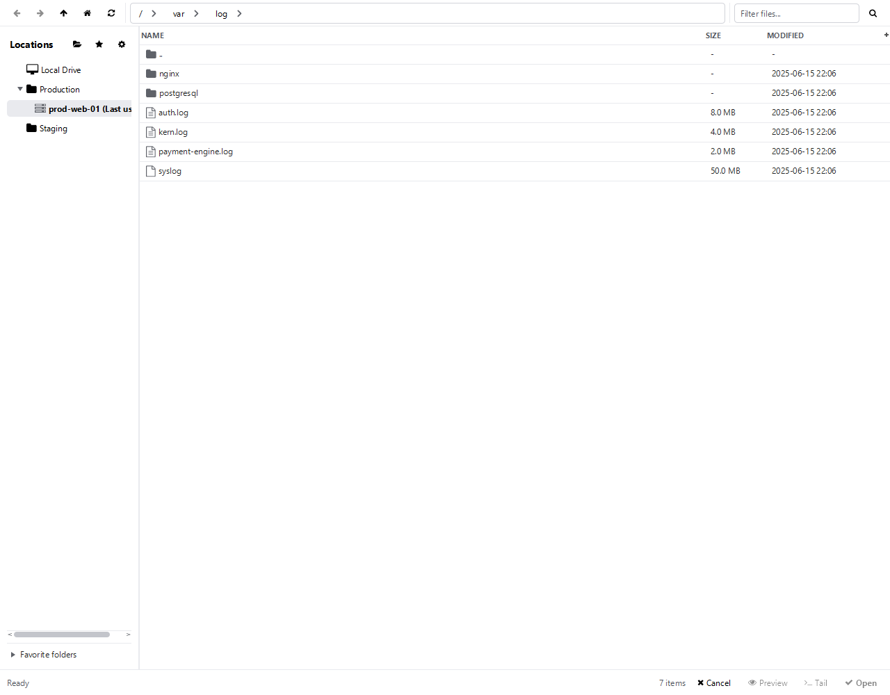

One browser for local drives and SSH servers, opened with **File → Open...**. It is also
where server groups and favourites live.

Browsing a local directory: Locations tree, breadcrumb, file table and footer actions.

## Locations panel

- **Local Drive** is always the first entry, followed by your server groups and then ungrouped servers.
- **New group...** creates a group inside the selected group (or at the top level); groups can be nested without limit, for example `Production/Database`.
- Right-click a group to **Rename** or **Delete** it. Deleting a group never deletes servers — they simply become ungrouped.
- Drag a server onto a group to move it, onto another server to join that server's group, or onto **Local Drive** / empty space to ungroup it. Dragging between two rows reorders the list; the order is saved.
- The star button marks the current folder as a favourite; favourites are grouped per location in the **Favorite folders** pane at the bottom.

The same browser on an SSH server: Location tree, remote breadcrumb and file listing.

## Navigation

| Control | Action |
| --- | --- |
| Back / Forward | Traverse the folder history of the selected location. <kbd>Backspace</kbd> goes back. |
| Up | Goes to the parent folder. |
| Home | Jumps to the location's starting folder (the server's **Default Path**, or your home directory). |
| Refresh | Re-reads the current folder. |
| Breadcrumb | Click any segment to jump to that folder; a menu appears for segments that do not fit. |
| Path field + Go | Type or paste a path and confirm with <kbd>Enter</kbd> or **Go**. |

## File list

- Columns: **Name**, **Size**, **Type**, **Modified**, **Permissions** and **Owner**. Click a header to sort; folders stay above files.
- **Search files...** filters the current listing by name as you type.
- Select a file to enable the footer actions: **Preview**, **Tail** and **Open**.
- **Preview** shows the first lines (limited by **Preferences → Log Viewer → Preview Line Limit**) and lets you copy selected lines with their numbers.
- Remote files are downloaded to the configured download directory before they open; the footer shows the progress.
