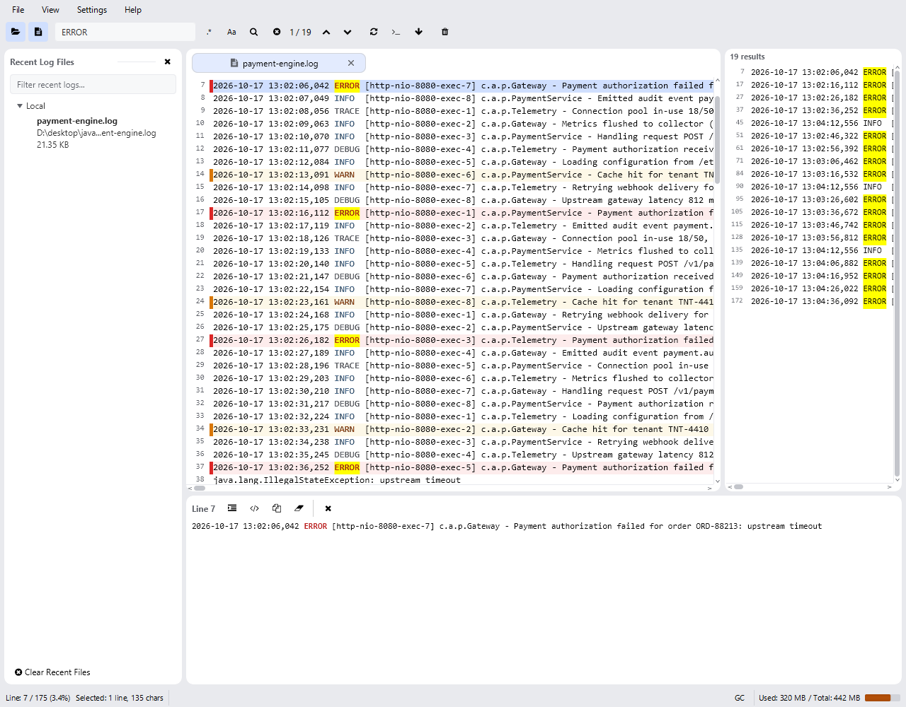
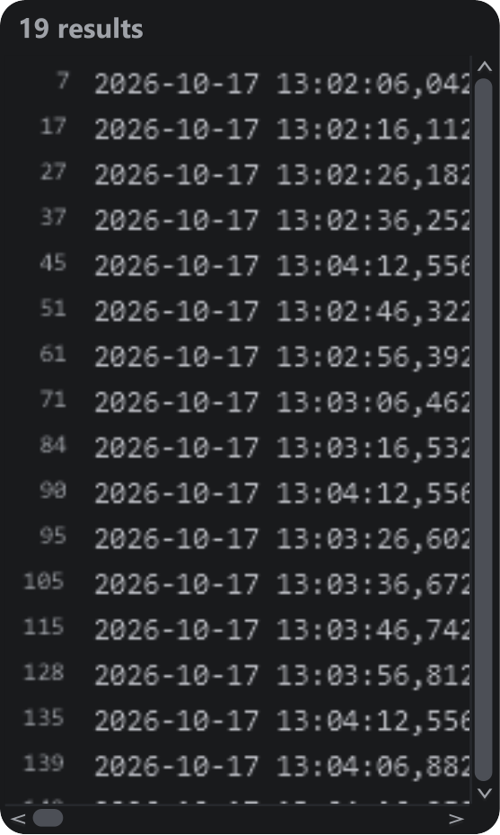

import { Steps } from '@astrojs/starlight/components';

The search field in the toolbar filters the log and highlights every match.

## Find timeout errors

<Steps>

1. **Enter a query.** Type `ERROR AND timeout` in the search field. Leave **Regex** off so `AND` is treated as a boolean operator.
2. **Apply the search.** Press <kbd>Enter</kbd> to immediately show lines containing both terms.
3. **Navigate results.** Use <kbd>F3</kbd> for the next match and <kbd>Shift+F3</kbd> for the previous one, or click a row in the **Search Result Panel**.
4. **Clear the filter.** Press <kbd>Escape</kbd> while the search field has focus to return to the full log.

</Steps>

Filtering on a term: highlights in the log, match counter in the toolbar and the result panel on the right. Select the image to enlarge it.

## Search options

| Feature | Description |
| --- | --- |
| Incremental search | Results update while you type (after a 300 ms pause); <kbd>Enter</kbd> applies immediately. |
| Regex | Enable **Regex** to treat the query as a regular expression. |
| Case Sensitive | Enable **Case Sensitive** for exact-case matching (off means case-insensitive). |
| Boolean terms | Combine words with uppercase `AND`, `OR` and `NOT`, for example `ERROR AND timeout` or `WARN NOT retry`. |
| Highlighting | Every matching term is highlighted in the log viewer. |
| Navigation | <kbd>F3</kbd> / <kbd>Shift+F3</kbd> move to the next / previous match and wrap around at the ends. |
| Match counter | The toolbar shows *"current / total"*. Counting stops after 50 000 matching lines and then reads *"50000+ matches"*; the result panel keeps listing the matches found so far. |
| Clearing | <kbd>Escape</kbd> in the search field clears the filter, or click the clear button. |

:::tip
Plain text and boolean searches are the fastest. Use regex when you need it, and avoid
patterns with heavy backtracking on multi-gigabyte files.
:::

## Search Result Panel

While a search is active, a panel lists every matching line.

Matches with their line numbers and highlighted keywords.

- Each row shows the line number and content, with the matching text highlighted.
- Click a row to jump to that line in the log viewer.
- Long lines scroll horizontally; the panel is hidden again when the search is cleared.
- During tailing, new matches are appended as lines arrive.
