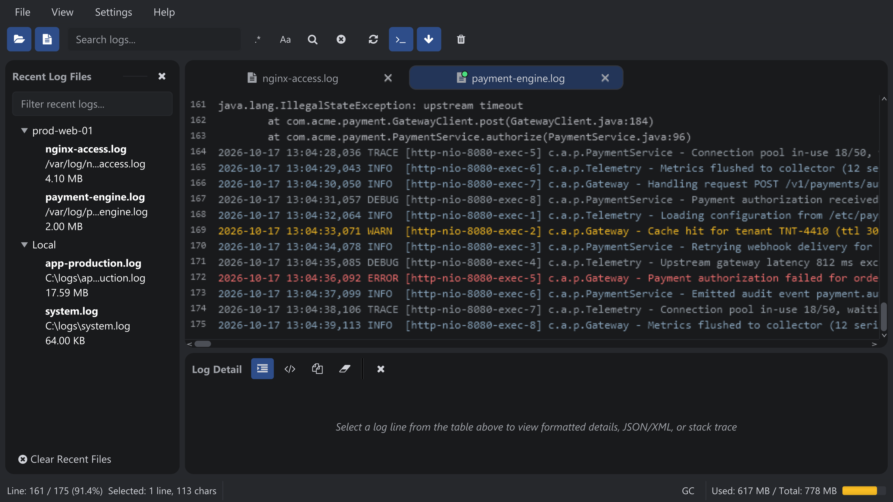

Tail mode streams new log entries as they are written, like `tail -f`. It works for
local files and remote files over SSH.

Following a file in real time: the tab shows a green live dot next to its name.

## How it works

- With a file open, click the **Tail** button (terminal icon). For local files the viewer watches the file and appends new lines.
- For remote files the app keeps a persistent SSH connection open and streams the output.
- **Smart Follow** keeps the view pinned to the newest lines. Scrolling up pauses it automatically; scrolling back to the bottom resumes it. The follow button toggles it manually.
- The tab shows a green dot while tailing, and the number of unread streamed lines is shown in the title when you switch away.
- The number of lines loaded when tailing starts comes from **Preferences → Log Viewer → Tail Window Size** (1000–100000, default 20000).
- Searches keep working while tailing: new lines are matched as they arrive and added to the result panel.

:::tip
**Clear** (toolbar, trash icon) stops tailing and empties the view but keeps the tab
open, so **Reload** (<kbd>Ctrl+R</kbd>) or enabling Tail again brings the same file back.
:::
