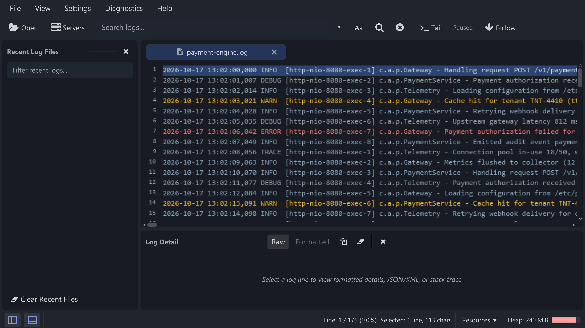
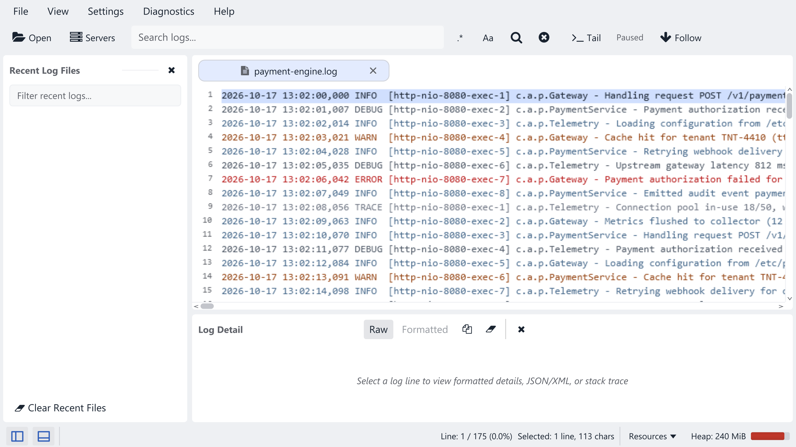

:::caution[Belum dirilis]
Halaman ini menjelaskan [branch pengembangan](https://github.com/ariefmahendra/seeloggyplus/tree/dev), bukan unduhan yang sudah diterbitkan. Versi stabil terbaru tetap **0.8.0**. Panduan lainnya masih menjelaskan versi stabil tersebut. Pembaruan dokumentasi ini tidak menerbitkan rilis aplikasi atau pembaruan otomatis baru.
:::

## Workspace dan kontrol panel

- Toolbar mengelompokkan aksi **Open / Servers**, pencarian, serta **Tail / Follow**.
- Tombol panel dipindahkan ke kiri bawah. Buka/tutup Recent Files dengan <kbd>Ctrl+B</kbd> dan Detail dengan <kbd>Ctrl+J</kbd>.
- Results dan Detail memiliki posisi **Auto**, **Right**, atau **Bottom** melalui menu View. Saat berbagi dock bawah, pilih tab panel untuk berpindah tampilan.
- Reload dan **Clear Log View** tersedia dari menu klik kanan tab log; <kbd>F5</kbd> dan **View → Refresh** tetap tersedia.
- Menu Resources dan penggunaan heap tetap terbaca di bar bawah, termasuk pada jendela sempit.

Build pengembangan. Antarmuka versi stabil 0.8.0 berbeda dari pratinjau ini.

## Detail Raw dan Formatted

Pilih **Raw** untuk baris asli atau **Formatted** untuk mendeteksi JSON/XML di dalamnya secara langsung. Toggle JSON/XML terpisah tidak diperlukan lagi. Payload yang tidak didukung atau rusak tetap terbaca dalam Raw; Formatted tidak tersedia jika baris tidak dapat diformat.

**Copy** mengikuti mode yang ditampilkan. Atur mode awal melalui **Preferences → Log Viewer**. Pemformatan payload besar berjalan di latar belakang, dan pekerjaan format lama tidak dapat menggantikan pilihan baris yang lebih baru.

## Warna dan startup

Ikon tombol menjadi biru saat hover, ditekan, dipilih, menu terbuka, dan fokus keyboard. Latar interaksinya memakai abu-abu netral sesuai tema Light/Dark. Aksi yang dinonaktifkan tetap redup.

Teks splash digambar pada resolusi layar, termasuk scaling high-DPI. Splash mulai sebelum persiapan workspace dan memuat animasi di latar belakang. Jeda sejak launcher diklik tetap bergantung pada startup JVM dan komputer.

## Pencarian dan memori

Pekerjaan pencarian lama tidak lagi menggantikan query baru, hasil tab lain, atau tampilan yang sudah dibersihkan. Hasil mempertahankan isi penuh baris panjang serta scrolling dan selection di dalam panel bersudut membulat.

Riwayat Tail memindahkan konten yang jarang diakses ke penyimpanan sementara dan mempertahankan hot cache berbatas ukuran, tanpa menurunkan batas riwayat yang sudah ada. Ini memakai ruang disk; penutupan sesi normal menghapus file spool, sedangkan penghentian paksa dapat meninggalkan file sementara. Pengukuran menunjukkan pemakaian memori lebih rendah pada workload yang diuji, tetapi beberapa workload indexing/pencarian lebih lambat. Hasil tersebut bukan jaminan performa untuk file atau komputer lain.

Data database yang sudah ada tetap dipertahankan; perubahan ini tidak menambah migrasi skema. Lihat [changelog](/id/changelog/) untuk rilis stabil dan catatan publikasi berikutnya.
