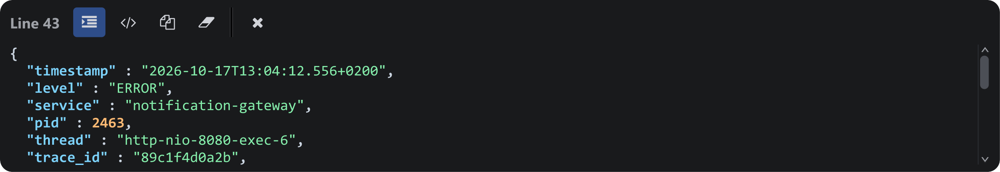

Klik atau pindah dengan tombol panah ke sebuah baris untuk menampilkan isi lengkapnya di
panel bawah, berguna untuk entri panjang dan data terstruktur yang disematkan.

Baris log yang berisi payload JSON, diformat oleh Auto Prettify JSON.

| Kontrol | Aksi |
| --- | --- |
| Auto Prettify JSON | Memformat JSON yang disematkan pada baris yang ditampilkan. Payload besar diformat di latar belakang agar UI tetap responsif. |
| Auto Prettify XML | Sama untuk XML yang disematkan, termasuk SOAP envelope dan namespace. |
| Copy | Menyalin persis apa yang ditampilkan (hasil prettify atau mentah) ke clipboard. |
| Clear | Mengosongkan panel tanpa menutupnya. |
| Close | Menyembunyikan panel; tampilkan kembali dengan <kbd>Ctrl+J</kbd> atau toggle di toolbar. |

:::tip
Toggle diingat per sesi dan juga tersedia di **Preferences → Log Viewer**. Panel ini
menggunakan font family dan ukuran dari **Preferences → General**.
:::
