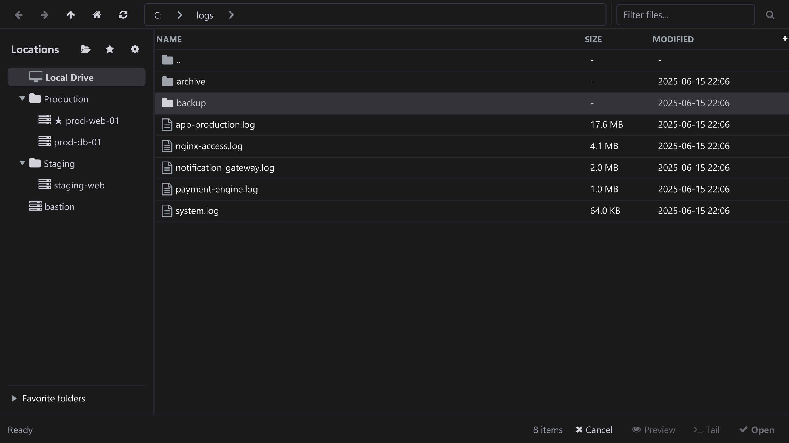
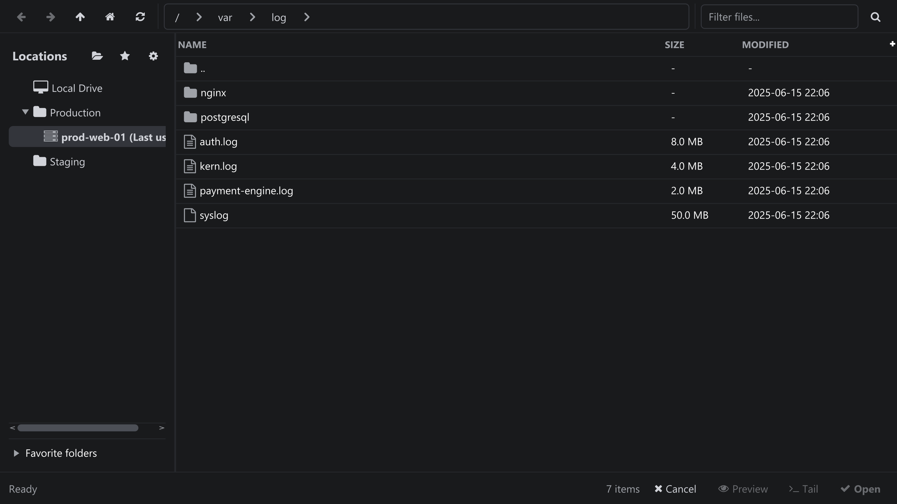

Satu penjelajah untuk drive lokal dan server SSH, dibuka dengan **File → Open...**. Di
sinilah grup server dan favorit juga berada.

Menelusuri direktori lokal: pohon Locations, breadcrumb, tabel file, dan aksi footer.

## Panel Locations

- **Local Drive** selalu menjadi entri pertama, diikuti grup server Anda, lalu server yang
  tidak dikelompokkan.
- **New group...** membuat grup di dalam grup yang dipilih (atau di level teratas); grup
  dapat disarangkan tanpa batas, misalnya `Production/Database`.
- Klik kanan sebuah grup untuk **Rename** atau **Delete**. Menghapus grup tidak pernah
  menghapus server — server hanya menjadi tidak dikelompokkan.
- Seret server ke sebuah grup untuk memindahkannya, ke server lain untuk bergabung dengan
  grup server tersebut, atau ke **Local Drive** / ruang kosong untuk melepasnya dari
  grup. Menyeret di antara dua baris mengubah urutan daftar; urutan tersebut disimpan.
- Tombol bintang menandai folder saat ini sebagai favorit; favorit dikelompokkan per
  lokasi di panel **Favorite folders** di bagian bawah.

Browser yang sama pada server SSH: pohon Location, breadcrumb remote, dan daftar file.

## Navigasi

| Kontrol | Aksi |
| --- | --- |
| Back / Forward | Menelusuri riwayat folder lokasi yang dipilih. <kbd>Backspace</kbd> untuk kembali. |
| Up | Berpindah ke folder induk. |
| Home | Melompat ke folder awal lokasi (**Default Path** server, atau direktori home Anda). |
| Refresh | Membaca ulang folder saat ini. |
| Breadcrumb | Klik segmen mana pun untuk melompat ke folder tersebut; menu muncul untuk segmen yang tidak muat. |
| Path field + Go | Ketik atau tempel path dan konfirmasi dengan <kbd>Enter</kbd> atau **Go**. |

## Daftar file

- Kolom: **Name**, **Size**, **Type**, **Modified**, **Permissions**, dan **Owner**. Klik
  header untuk mengurutkan; folder selalu berada di atas file.
- **Search files...** memfilter daftar saat ini berdasarkan nama sambil Anda mengetik.
- Pilih sebuah file untuk mengaktifkan aksi di footer: **Preview**, **Tail**, dan **Open**.
- **Preview** menampilkan baris-baris pertama (dibatasi oleh **Preferences → Log Viewer →
  Preview Line Limit**) dan memungkinkan Anda menyalin baris terpilih beserta nomornya.
- File remote diunduh ke direktori unduhan yang dikonfigurasi sebelum dibuka; progresnya
  ditampilkan di footer.
