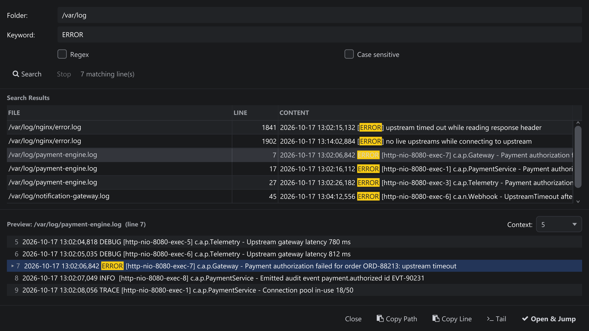

Mencari kata kunci di dalam setiap file dalam folder remote — berguna saat Anda belum tahu
log mana yang memuat error. Tombol ini hanya aktif saat lokasi server remote dipilih;
untuk saat ini, folder lokal dicari dari command line.

Kecocokan di seluruh folder remote dengan konteks di sekitarnya di preview.

| Kontrol | Aksi |
| --- | --- |
| Folder / Keyword | Folder remote yang akan dipindai (default-nya path saat ini) dan teks yang dicari. |
| Regex / Case sensitive | Beralih ke extended regular expression, dan/atau mencocokkan huruf besar-kecil secara persis. |
| Search / Stop | Memulai pemindaian dengan indikator progres; **Stop** membatalkannya. |
| Results | File, nomor baris, dan konten per kecocokan, dengan kata kunci disorot. Klik baris untuk memuat konteksnya di bawah. |
| Context | Jumlah baris di sekitarnya yang ditampilkan di preview; baris yang cocok ditandai. |
| Footer | **Copy Path**, **Copy Line**, **Tail** (merekomendasikan jump window) dan **Open & Jump**. |

:::tip
Pemindaian berhenti setelah kecocokan yang sangat banyak agar daftar hasil tetap dapat
digunakan. Persempit folder (misalnya `/var/log/nginx`) atau gunakan regex yang lebih
spesifik ketika hasil pemindaian terlalu banyak.
:::
