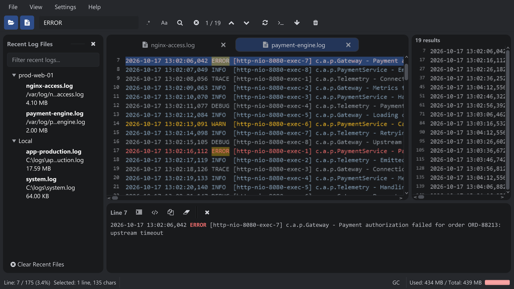
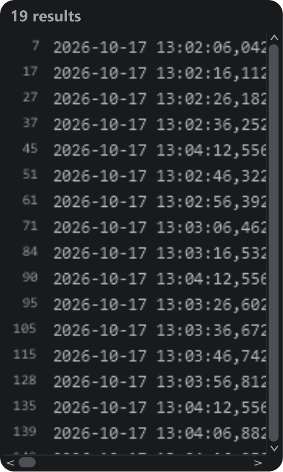

import { Steps } from '@astrojs/starlight/components';

Kolom pencarian di toolbar memfilter log dan menyorot setiap kecocokan.

## Cari error timeout

<Steps>

1. **Masukkan kueri.** Ketik `ERROR AND timeout` di kolom pencarian. Biarkan **Regex** nonaktif agar `AND` diperlakukan sebagai operator boolean.
2. **Terapkan pencarian.** Tekan <kbd>Enter</kbd> untuk langsung menampilkan baris yang memuat kedua istilah.
3. **Telusuri hasil.** Gunakan <kbd>F3</kbd> untuk kecocokan berikutnya dan <kbd>Shift+F3</kbd> untuk sebelumnya, atau klik baris di **Search Result Panel** (panel hasil pencarian).
4. **Hapus filter.** Tekan <kbd>Escape</kbd> saat fokus berada di kolom pencarian untuk kembali ke log lengkap.

</Steps>

Memfilter berdasarkan istilah: sorotan di log, penghitung kecocokan di toolbar, dan panel hasil di sebelah kanan. Tekan gambar untuk memperbesar.

## Opsi pencarian

| Fitur | Deskripsi |
| --- | --- |
| Pencarian inkremental | Hasil diperbarui sambil Anda mengetik (setelah jeda 300 ms); <kbd>Enter</kbd> langsung menerapkannya. |
| Regex | Aktifkan **Regex** agar kueri diperlakukan sebagai regular expression. |
| Case Sensitive | Aktifkan **Case Sensitive** untuk pencocokan huruf besar-kecil secara persis (nonaktif berarti tidak peka huruf besar-kecil). |
| Istilah boolean | Gabungkan kata dengan `AND`, `OR`, dan `NOT` huruf kapital, misalnya `ERROR AND timeout` atau `WARN NOT retry`. |
| Penyorotan | Setiap istilah yang cocok disorot di log viewer. |
| Navigasi | <kbd>F3</kbd> / <kbd>Shift+F3</kbd> berpindah ke kecocokan berikutnya / sebelumnya dan kembali ke ujung satunya setelah mencapai akhir. |
| Penghitung kecocokan | Toolbar menampilkan *"current / total"*. Penghitungan berhenti setelah 50 000 baris yang cocok, lalu menampilkan *"50000+ matches"*; panel hasil tetap mencantumkan kecocokan yang ditemukan sejauh ini. |
| Menghapus filter | <kbd>Escape</kbd> di kolom pencarian menghapus filter, atau klik tombol clear. |

:::tip
Pencarian teks biasa dan boolean adalah yang tercepat. Gunakan regex saat memang perlu, dan
hindari pola dengan backtracking berat pada file berukuran multi-gigabyte.
:::

## Panel hasil pencarian

Selama pencarian aktif, **Search Result Panel** mencantumkan setiap baris yang cocok.

Kecocokan dengan nomor baris dan kata kunci yang disorot.

- Setiap baris menampilkan nomor baris dan kontennya, dengan teks yang cocok disorot.
- Klik sebuah baris untuk melompat ke baris tersebut di log viewer.
- Baris panjang digulir secara horizontal; panel disembunyikan lagi saat pencarian dihapus.
- Selama tailing, kecocokan baru ditambahkan begitu baris tiba.
