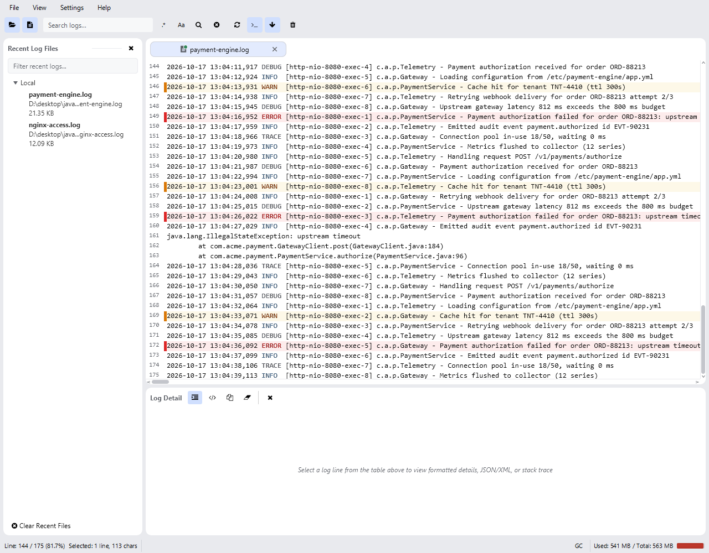

Mode tail mengalirkan entri log baru begitu ditulis, seperti `tail -f`. Fitur ini berfungsi
untuk file lokal dan file remote melalui SSH.

Mengikuti file secara real time: tab menampilkan titik hijau live di samping namanya.

## Cara kerja

- Dengan file terbuka, klik tombol **Tail** (ikon terminal). Untuk file lokal, viewer
  memantau file dan menambahkan baris-baris baru.
- Untuk file remote, aplikasi mempertahankan koneksi SSH yang persisten dan mengalirkan
  output-nya.
- **Smart Follow** menjaga tampilan tetap terpaku pada baris-baris terbaru. Menggulir ke
  atas menjedanya secara otomatis; menggulir kembali ke bawah melanjutkannya. Tombol
  follow mengaktifkan atau menonaktifkannya secara manual.
- Tab menampilkan titik hijau selama tailing, dan jumlah baris hasil streaming yang belum
  dibaca ditampilkan di judul saat Anda beralih dari tab tersebut.
- Jumlah baris yang dimuat saat tailing dimulai berasal dari **Preferences → Log Viewer →
  Tail Window Size** (1000–100000, default 20000).
- Pencarian tetap berjalan selama tailing: baris-baris baru dicocokkan saat tiba dan
  ditambahkan ke panel hasil.

:::tip
**Clear** (toolbar, ikon tong sampah) menghentikan tailing dan mengosongkan tampilan tetapi
membiarkan tab tetap terbuka, sehingga **Reload** (<kbd>Ctrl+R</kbd>) atau mengaktifkan
Tail lagi akan memuat kembali file yang sama.
:::
