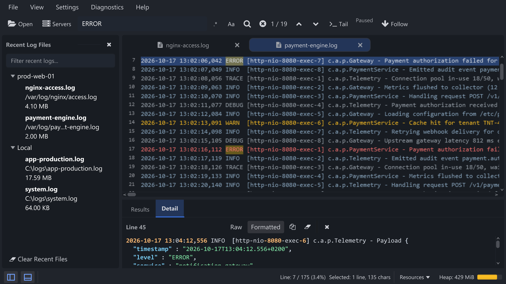

Ruang kerja terbagi menjadi beberapa area. Setiap panel dapat disembunyikan dan muncul
kembali dengan pintasannya.

Ringkasan tata letak: file terbaru, log viewer, hasil pencarian, dan panel Detail.

| Area | Fungsi |
| --- | --- |
| Menu bar | Perintah File, View, Settings, dan Help. Akselerator menu berfungsi selama jendela dalam fokus. |
| Toolbar | Open/Servers, pencarian dengan **Regex** / **Case Sensitive**, navigator kecocokan, serta Tail/Follow. Reload dan Clear Log View ada di menu klik kanan tab log. |
| Recent Log Files | File yang pernah dibuka, dikelompokkan berdasarkan sumber. Buka/tutup dengan <kbd>Ctrl+B</kbd>. |
| Log viewer | Baris canvas dengan nomor baris, warna teks sesuai tingkat keparahan, selection per karakter, dan sorotan pencarian. |
| Search Result Panel | Menampilkan kecocokan di dock Auto/Right/Bottom yang dipilih. Klik hasil untuk menuju baris tersebut. |
| Panel Detail | Isi lengkap baris dengan mode Raw/Formatted dan Copy. Buka/tutup dengan <kbd>Ctrl+J</kbd>. |
| Status bar | Tombol panel, baris saat ini dan totalnya, ukuran seleksi, Resources, dan heap dengan bar berkode warna. |

Pilih **View → Results Position → Auto / Right / Bottom** untuk menempatkan Results dan Detail. Pada dock bawah bersama, gunakan tab panel untuk berpindah. **View → Reset Layout** mengembalikan layout awal.

## Tab

- Setiap file yang dibuka mendapat tabnya sendiri. Header tab menyusut saat makin banyak tab dibuka dan melebar kembali saat tab ditutup (<kbd>Ctrl+Tab</kbd> / <kbd>Ctrl+Shift+Tab</kbd> untuk berpindah, <kbd>Ctrl+W</kbd> untuk menutup).
- Titik hijau menandai tab yang sedang tailing; baris hasil streaming yang belum dibaca dihitung di judul (maksimum 999).
- Seret header tab untuk menyusun ulang urutan tab. Menggulir di atas header tab akan memindahkan pilihan.
- Klik kanan pada tab untuk **Close**, **Close Tabs to the Right**, **Close Other Tabs**, **Close All Tabs**, **Reload**, **Copy File Path**, dan **Show in File Explorer**.

## Status bar

| Elemen | Arti |
| --- | --- |
| **Line: 143 / 175 (81.1%)** | Baris teratas yang terlihat, total baris pada tampilan saat ini, dan posisi gulir. Klik untuk membuka **Go To Line** (<kbd>Ctrl+G</kbd>). |
| **Selected: 3 lines, 120 chars** | Muncul saat teks dipilih; lihat [Memilih & Menyalin Teks](/id/guides/selection/). |
| **Ikon panel** | Buka/tutup Recent Files dan Detail; ikon aktif biru dengan latar abu-abu. |
| **Resources** | Membuka detail heap dan sesi. Gunakan Diagnostics > Run Garbage Collection bila diperlukan. |
| **Memory** | Heap terpakai / total dengan bar yang berubah kuning di atas 60% dan merah di atas 85%. |
| **Pemberitahuan pembaruan** | Tautan yang dapat diklik muncul ketika rilis yang lebih baru tersedia. |
