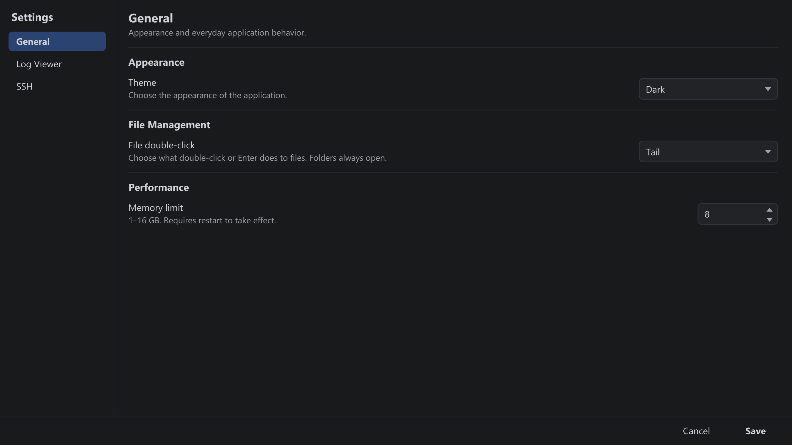
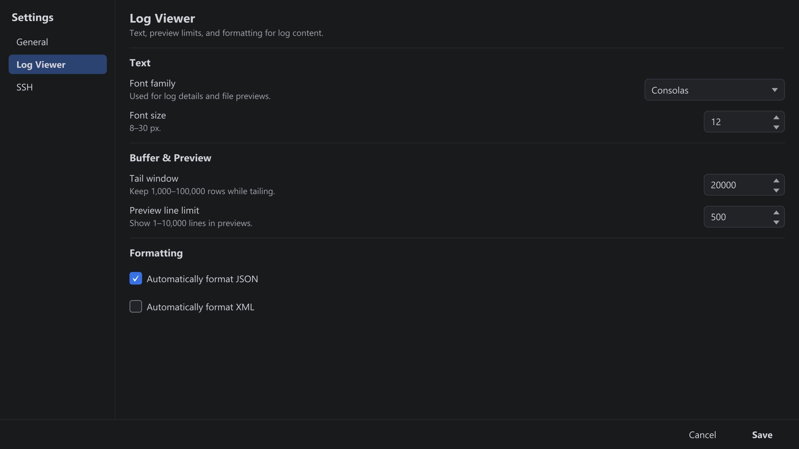
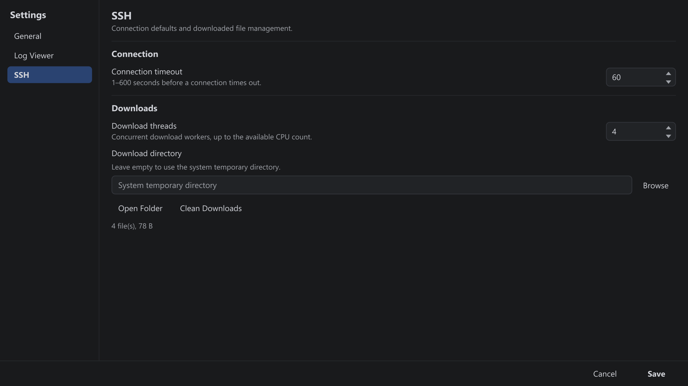

Buka dengan **Settings → Preferences...**. Pengaturan disimpan secara lokal dan berlaku
setelah **Save**; beberapa di antaranya memerlukan restart, seperti dijelaskan di bawah.

Preferensi → General.

## General

| Pengaturan | Deskripsi |
| --- | --- |
| Theme | **Light** (default) atau **Dark**. Perubahan langsung diterapkan ke semua jendela. |
| File double-click | **Open/Download** (default) atau **Tail** untuk file di File Manager. Folder selalu terbuka; <kbd>Enter</kbd> mengikuti pengaturan yang sama. |
| Max Memory | 1–16 GB memori heap. **Perlu restart.** Naikkan untuk file yang sangat besar. |

Preferensi → Log Viewer.

## Log Viewer

| Pengaturan | Deskripsi |
| --- | --- |
| Font Size | 8–30 px. Berlaku untuk panel Detail dan pratinjau file. |
| Font Family | Font family apa pun yang terpasang; font monospace paling cocok untuk log. |
| Tail Window Size | 1000–100000 baris (default 20000). Jumlah baris yang dimuat saat tailing dimulai. |
| Preview Line Limit | 1–10000 baris yang ditampilkan saat pratinjau file di File Manager. |
| Auto Prettify JSON / XML | Format payload terstruktur secara otomatis di panel Detail. |

Preferensi → SSH.

## SSH

| Pengaturan | Deskripsi |
| --- | --- |
| Download Threads | 1 hingga jumlah CPU yang tersedia yang digunakan saat mengunduh file remote. |
| Connection Timeout | 1–600 detik sebelum upaya koneksi dibatalkan. |
| Download Directory | Tempat penyimpanan file remote yang diunduh (default: direktori temp sistem). **Open Folder** membukanya, **Clean Downloads** menghapus file-file tersebut. |
