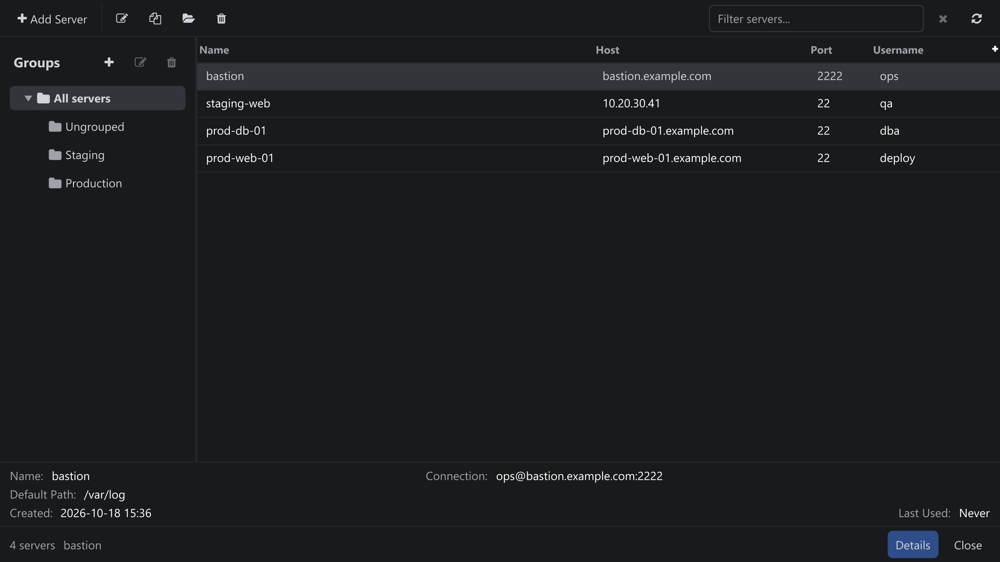
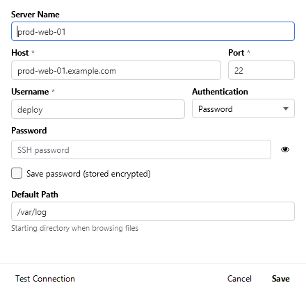

Tambah, edit, clone, dan hapus server SSH melalui **Settings → Server Management...**
(<kbd>Ctrl+M</kbd>).

Daftar server dengan grup di sebelah kiri dan detail server yang dipilih.

| Kontrol | Aksi |
| --- | --- |
| Add Server | Membuka formulir di bawah dengan kolom-kolom kosong. |
| Edit / Clone | Edit mengubah server yang dipilih; Clone menduplikasinya (berguna untuk pengguna atau port kedua). |
| Delete | Menghapus server. Entri Recent yang mengarah ke server tersebut menjelaskan cara memindahkannya. |
| Search / Clear | Memfilter daftar berdasarkan nama, host, grup, atau username. |
| Columns | Name, Group, Host, Port, Username, Default Path, dan Last Used. |
| Server groups | Pohon di sebelah kiri mencerminkan grup File Manager: **New group...**, **Rename...**, **Delete group**, dan **Move selected server...**. Menghapus grup melepaskan server di dalamnya dari grup, bukan menghapusnya. |
| Server Details | Ringkasan hanya-baca dari server yang dipilih, termasuk kapan server dibuat dan terakhir digunakan. |

Formulir add/edit dengan autentikasi password yang dipilih.

## Formulir Add / Edit Server

| Kolom | Deskripsi |
| --- | --- |
| Server Name | Label yang ditampilkan di File Manager, panel Recent, dan judul tab. |
| Host / Port | Hostname atau alamat IP dan port SSH (default 22). |
| Username | Akun SSH yang digunakan untuk menelusuri, mengunduh, dan tailing. |
| Authentication | **Password** atau **Private Key**. Untuk password, Anda dapat menampilkan kolomnya dengan tombol mata; untuk key, pilih file key dan, jika terenkripsi, passphrase-nya. |
| Save password / passphrase | Menyimpan secret secara terenkripsi di keystore lokal. Biarkan tidak dicentang agar diminta setiap kali terhubung. |
| Default Path | Folder yang dibuka File Manager untuk server ini, misalnya `/var/log`. |
| Test Connection | Memverifikasi host, kredensial, dan host key sebelum Anda menyimpan. |
