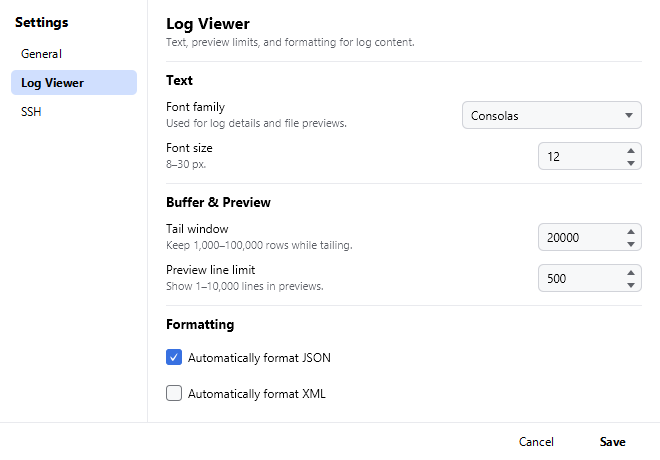
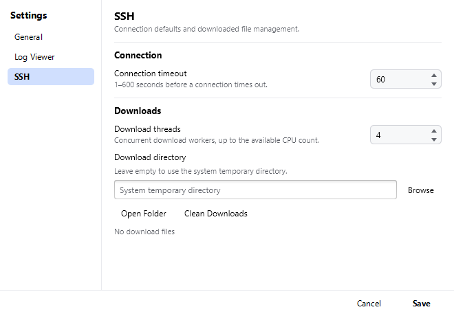

Open with **Settings → Preferences...**. Settings are stored locally and apply after
**Save**; a few need a restart, as noted below.

Preferences → General.

## General

| Setting | Description |
| --- | --- |
| Font Size | 8–30 px. Applies to the Detail panel and file previews. |
| Font Family | Any installed family; monospace fonts work best for logs. |
| Theme | **Light** (default) or **Dark**. The change is applied immediately to every window. |
| File double-click | **Open/Download** (default) or **Tail** for files in the File Manager. Folders always open; <kbd>Enter</kbd> follows the same setting. |
| Max Memory | 1–16 GB of heap. **A restart is required.** Raise it for very large files. |

Preferences → Log Viewer.

## Log Viewer

| Setting | Description |
| --- | --- |
| Tail Window Size | 1000–100000 lines (default 20000). How many lines are loaded when tailing starts. |
| Preview Line Limit | 1–10000 lines shown when previewing a file in the File Manager. |
| Auto Prettify JSON / XML | Format structured payloads automatically in the Detail panel. |

Preferences → SSH.

## SSH

| Setting | Description |
| --- | --- |
| Download Threads | 1–16 parallel threads used when downloading remote files. |
| Connection Timeout | 1–600 seconds before a connection attempt is abandoned. |
| Download Directory | Where downloaded remote files are stored (default: the system temp directory). **Open Folder** reveals it, **Clean Downloads** deletes the files. |
