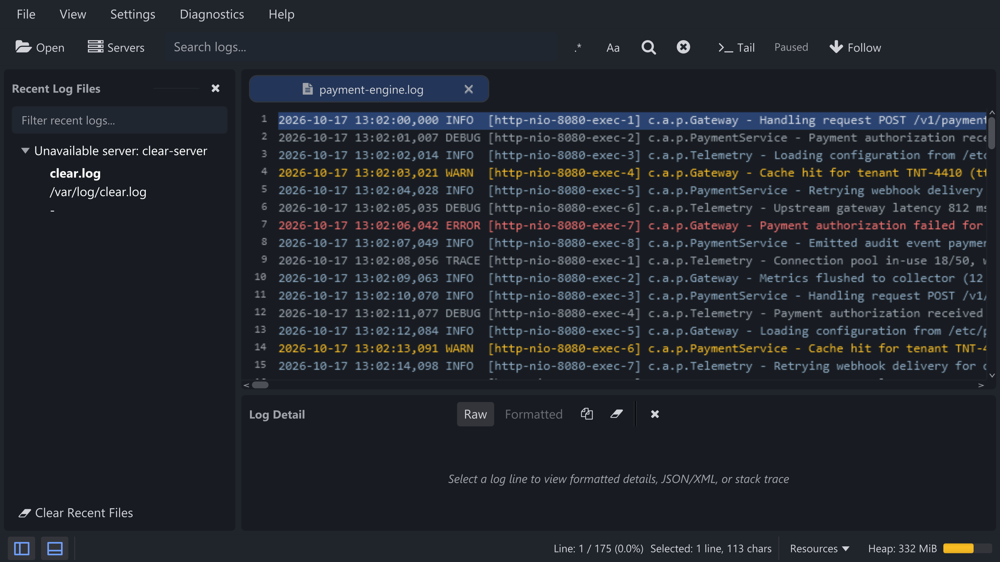
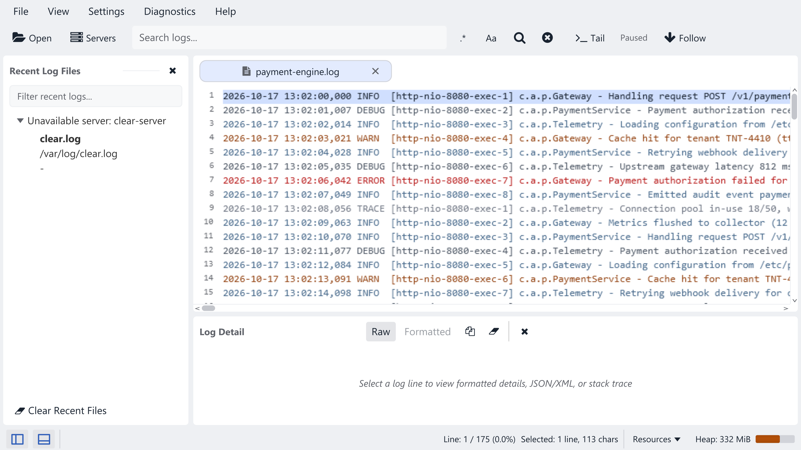

:::note[SeeLoggyPlus 0.9.0]
These features are available in [release 0.9.0](https://github.com/ariefmahendra/seeloggyplus/releases/tag/0.9.0). Follow the [installation guide](/installation/) to install or upgrade.
:::

## Workspace and panel controls

- The toolbar groups **Open / Servers**, search, and **Tail / Follow** actions.
- Panel buttons move to the bottom-left corner. Toggle Recent Files with <kbd>Ctrl+B</kbd> and Detail with <kbd>Ctrl+J</kbd>.
- Results and Detail use configurable **Auto**, **Right** or **Bottom** docking from the View menu. When sharing the bottom dock, choose their tabs to switch views.
- Reload and **Clear Log View** are available from the log tab's context menu; <kbd>F5</kbd> and **View → Refresh** remain available.
- The Resources menu and heap usage remain readable in the bottom bar, including at narrow window widths.

SeeLoggyPlus 0.9.0 workspace in the Dark theme.

## Raw and Formatted detail

Select **Raw** for the original line, or **Formatted** to detect embedded JSON/XML directly. Separate JSON/XML toggles are no longer required. Unsupported or malformed payloads stay readable in Raw mode; Formatted is unavailable when the line cannot be formatted.

**Copy** follows the displayed mode. Set the default in **Preferences → Log Viewer**. Formatting large payloads runs in the background, and old formatting jobs cannot replace a newer selection.

## Colors and startup

Button icons become blue on hover, press, selection, open menus and keyboard focus. Their interaction backgrounds use neutral gray shades that follow Light/Dark themes. Disabled actions remain dimmed.

Splash text renders at display resolution, including high-DPI scaling. The splash starts before workspace preparation and loads its animation in the background. The time from clicking a launcher still depends on JVM startup and the computer.

## Search and memory

Stale search jobs no longer replace newer queries, another tab's results, or a cleared view. Results retain complete long lines and preserve scrolling and selection inside rounded panels.

Tail history moves cold content to temporary storage and keeps a bounded hot cache without reducing its existing history limit. This uses disk space; normal session close removes its spool files, while a forced exit may leave temporary files behind. Measurements show lower memory usage in the tested workload, but some indexing/search workloads are slower. These results are not a performance guarantee for other files or computers.

Existing database data is retained; these changes do not add a schema migration. See the [changelog](/changelog/) for stable releases and future publication notes.
